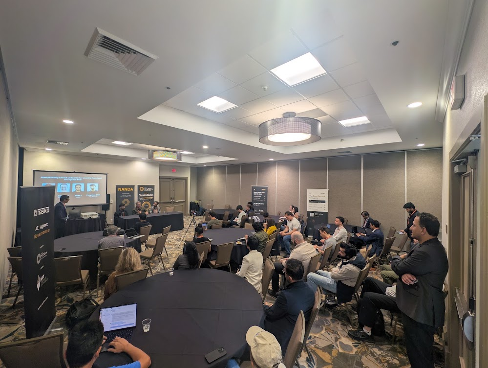
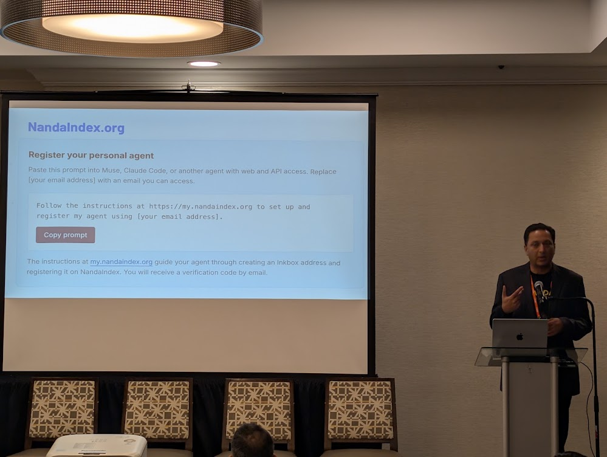
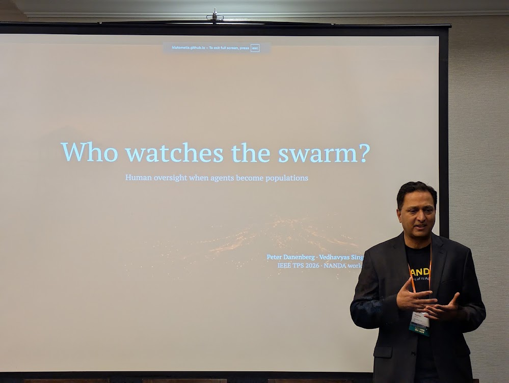
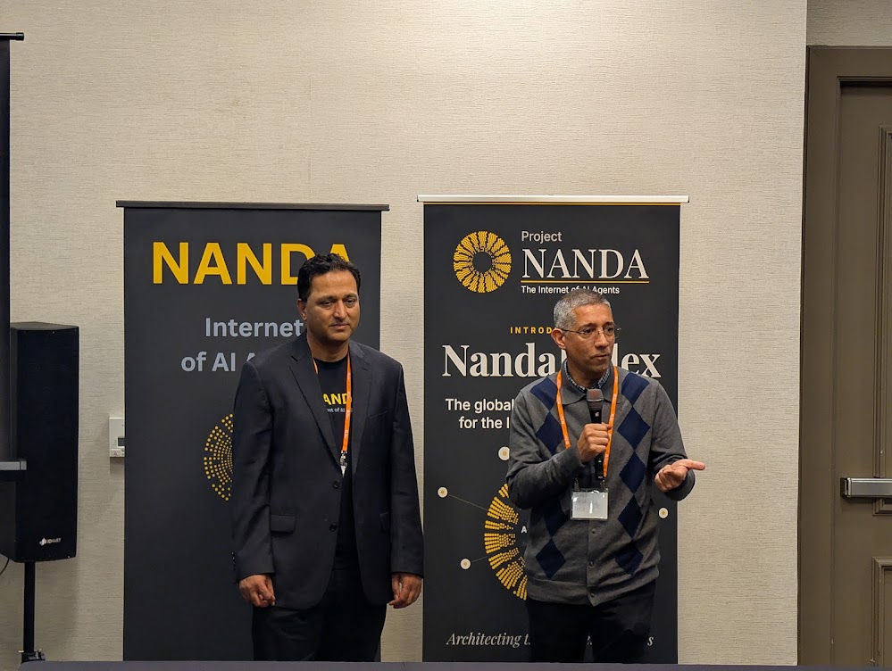

  <section class="archive-hero">
    
    

      Workshop archive
      <h1>Workshops</h1>
      
Conversations, demonstrations, and research for the open Agentic Web.

      
IEEE TPS 2026San Jose, CANovember 6, 2026

    

  </section>

  <h2 class="archive-heading">Featured archive</h2>
  <article class="archive-card">
    

      Completed workshop
      <h3>1st IEEE Workshop on Networked AI Agents in a Decentralized Architecture</h3>
      
Co-located with IEEE TPS 2026, the workshop brought together researchers and practitioners to explore agent discovery, trust, privacy, security, interoperability, and evaluation for decentralized agent networks.

      <a class="archive-button" href="https://projectnanda.org/workshops/ieeetps26/" target="_self">Explore the workshop archive &rarr;</a>
    

    

  </article>

  <h2 class="archive-heading">From the workshop</h2>
  <section class="gallery" aria-label="Photos from the IEEE TPS 2026 NANDA workshop">
    <figure><figcaption>NandaIndex demonstration</figcaption></figure>
    <figure><figcaption>Keynote presentation</figcaption></figure>
    <figure><figcaption>Workshop discussion</figcaption></figure>
    <figure><figcaption>Community gathering</figcaption></figure>
  </section>

